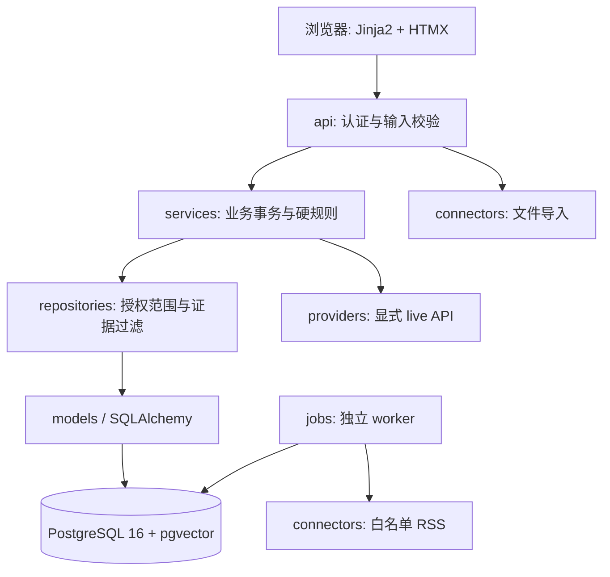

# 工程结构

当前结构保留最初约定的目录和工具入口，不为整理目录改动业务代码或 Python 导入路径。状态见 [开发进度](../development/status.md)。

```text
support-copilot/
├── app/                       # 应用源代码
│   ├── api/                   # HTTP 接口与认证/CSRF 依赖
│   ├── services/              # 问答、回复、知识审核、安全规则
│   ├── repositories/          # 数据访问与统一客户授权过滤
│   ├── models/                # SQLAlchemy 数据模型
│   ├── schemas/               # Pydantic 输入/输出契约
│   ├── providers/             # 生成与 embedding HTTP 客户端
│   ├── connectors/            # 平台文件导入与 RSS 解析
│   ├── jobs/                  # 独立 worker 和持久化任务
│   ├── templates/             # Jinja2 模板；当前待实现
│   ├── static/vendor/         # 固定版本第三方前端资源
│   ├── config.py              # 服务端配置与模式约束
│   └── db.py                  # Engine、Session 和 Base
├── migrations/                # Alembic 修订与冻结 SQL
├── fixtures/                  # 产品、客户、平台消息、资讯演示输入
├── tests/{unit,integration,e2e}/
├── evals/                     # 固定业务评估；当前待实现
├── scripts/                   # 显式执行的维护及静态检查入口
├── docs/
│   ├── requirements/          # 原始需求、验收要求
│   ├── architecture/          # 模块职责和边界
│   ├── deployment/            # 部署位置、持久化、预定启动步骤
│   ├── decisions/             # 架构与协作决策记录
│   ├── development/           # 当前状态、验证和环境记录
│   └── ai-history/            # 开发交流记录，不是业务知识
├── Dockerfile / compose.yaml  # 容器构建和三服务编排
├── pyproject.toml / uv.lock    # 依赖定义与唯一锁定来源
├── requirements*.txt          # 锁文件导出，保留根目录兼容性
├── Makefile / alembic.ini      # 开发命令与迁移入口
├── .env.example               # 不含真实密钥的配置模板
├── README.md / CONTRIBUTING.md / AGENTS.md
└── .gitignore / .dockerignore
```

## 模块职责

| 层 | 当前文件举例 | 职责与边界 |
| --- | --- | --- |
| HTTP | `app/api/deps.py` | 认证、会话、CSRF；路由与 Web 入口尚待实现 |
| 业务 | `app/services/answers.py`, `knowledge.py` | 问答和审核事务，不直接信任前端 customer/role |
| 数据访问 | `app/repositories/access.py` | 组织、分配客户、来源、版本、发布状态过滤入口 |
| 模型与契约 | `app/models/entities.py`, `app/schemas/answer.py` | 持久化模型与结构化答案契约 |
| 外部 API | `app/providers/ai.py` | 生成/embedding 单独配置；失败显式返回错误 |
| 输入连接 | `app/connectors/imports.py`, `news.py` | 导入解析、服务器群绑定与 RSS 白名单 |
| 后台执行 | `app/jobs/worker.py` | PostgreSQL 任务及锁；不由 Web 进程启动 |

上表是代码职责说明，不是安全审计或运行验证结论。现有 service 中仍有直接 ORM 操作，后续实现须确保所有客户作用域数据读取统一受 repository 策略约束，不能因为目录已分层就声称权限闭环完成。

## 目标调用关系



## 内容与数据隔离

- `fixtures/` 只包含明确标注的虚构演示输入，不存放真实客户导出。
- `docs/ai-history/` 不属于检索来源，禁止导入产品问答索引。
- `.env`、`.venv/`、`__pycache__/`、`.ruff_cache/`、日志和本地报告不是源码交付内容；仅通过忽略规则排除，本次不删除。
- 数据库数据存部署主机的持久卷，不放进 Git；见 [部署说明](../deployment/README.md)。
- 根目录保留 Dockerfile、Compose、requirements，避免改动常用部署约定与原始需求。
