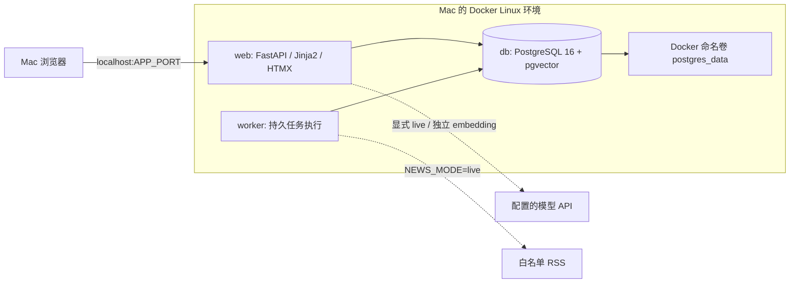
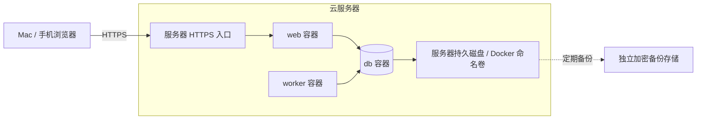

# 部署边界与数据落点

返回 [文档索引](../README.md) · 查看 [开发状态](../development/status.md)

## 本地演示



仅浏览器运行在 macOS 原生环境；应用依赖、Python 3.12 与 uv 随镜像提供。Docker 运行时本身必须由用户安装，本仓库不会安装。导入的是用户上传的导出文件，不是自动读取个人企微或飞书客户端。

## 云服务器



HTTPS 入口和备份系统由部署环境提供，不加入 MVP 的三服务 Compose。当前没有执行任何云端创建或部署。需要正式上线时再选择云厂商、区域、域名、访问控制与备份策略。

## 数据库在哪里

| 数据 | 保存位置 | Git 中是否保存 |
| --- | --- | --- |
| 数据模型、迁移、演示 fixtures | repo | 是 |
| 会话、导入原文、知识、向量、用户权限 | PostgreSQL 数据卷 | 否 |
| 回复动作、反馈、资讯、任务、审计 | PostgreSQL 数据卷 | 否 |
| 密钥、会话密钥、部署密码 | 部署主机环境变量 / `.env` | 否 |
| 运行及数据库备份 | 部署环境的受控存储 | 否 |

一个部署实例的 web 和 worker 必须连接同一个 PostgreSQL。任务队列就在数据库，不使用 Redis，也不在 web 中运行后台调度。删除容器不等于删除命名卷；命名卷也不等于备份。

## 模型不等于应用托管

使用云模型 API 并不意味着整个应用或数据库在云模型厂商处运行。`AI_MODE=live` 会把当前授权客户的问题、有限上下文与检索证据发送到所配置的生成 API；启用 embedding 会把文本发送到独立配置的 embedding API。这些传输需要客户授权、服务商条款审查和数据保留政策。mock 模式不做这些传输。

模型 API 可以部署在企业内网，也可以是外部服务，具体由 BASE_URL 决定。配置中不预置任何真实账号或密钥。没有模型密钥时保持 mock，不能将离线结果标成真实模型效果。

## 生产差异

- 单机三容器只适合受控演示或小规模验证，不提供数据库高可用保证。
- 正式部署优先评估私网托管 PostgreSQL 16 + pgvector；需单独提供部署覆盖配置，将 web/worker 指向托管数据库并停用本地 db 服务。当前尚未实现该覆盖配置。
- 数据库端口不对公网开放。默认 HTTP 仅绑定主机 `127.0.0.1`，由同主机 HTTPS 入口代理；不要直接暴露开发服务。
- `POSTGRES_PASSWORD` 示例仅限本地演示，生产必须随机化。URL 中的密码应使用 URL-safe 字符，复杂凭据需正确百分号编码。
- PostgreSQL 首次初始化后，修改环境变量不会自动修改已有数据库角色密码，需要数据库内显式轮换。
- 现有 `.env` 不会被覆盖；模板新增字段可由部署者检查后补充。
- Docker 镜像构建、ARM64/AMD64 实际启动、Web 健康检查与完整测试目前均未验证。

## 配置与依赖入口

- 根目录 `pyproject.toml` 定义直接依赖，`uv.lock` 锁定完整依赖图。
- `requirements.txt` 和 `requirements-dev.txt` 从锁文件导出，供使用 pip 的平台参考，不是另一套版本来源。
- Dockerfile 内提供 Python 3.12 和 uv，以非 root 用户运行；不要求 Mac 原生安装这套运行栈。
- `.env.example` 只含演示配置。`scripts/init_env.py` 不覆盖已有 `.env`；`.env` 排除于 Git 和 Docker 构建上下文。
- 默认 `AI_MODE=mock`、`NEWS_MODE=replay`、`SEND_MODE=manual`；embedding 独立配置，默认关闭。BM25 mock 使用确定性证据摘录，不伪造 embedding。
- 容器内数据库地址为 `db:5432`，不是 `localhost:5432`。Compose 从 `POSTGRES_PASSWORD` 统一构造 web/worker 的 DATABASE_URL。
- `APP_PORT` 改变宿主 HTTP 端口，容器内保持 8000。默认仅绑定 `127.0.0.1`。
- 用户、授权、会话、导入原文、知识修订、片段、向量、回复、资讯、任务和审计的存储目标均为 PostgreSQL；当前没有落盘附件功能。

## 预定启动流程

**入口实现后、且用户授权准备 Docker 环境时再执行。当前不能据此宣称可以运行。**

```sh
make init    # 首次创建 .env（不覆盖已有文件），构建镜像
make config  # 检查 Compose 配置
make up      # 启动 db，执行迁移，再启动 web 与 worker
make seed    # 幂等导入演示数据；生产环境拒绝执行
make test
make eval
make down    # 停止服务，保留数据库卷
```

预定本地地址 `http://localhost:8000`，当前未启动服务，不能用于演示。`make up` 引用的 Web/健康检查入口和 `make eval` 引用的评估入口仍缺失，详见 [开发状态](../development/status.md)。

云端执行同一套命令，但先设置随机数据库密码、SESSION_SECRET、`ENVIRONMENT=production`、`COOKIE_SECURE=true`，更换默认凭据，并配置 HTTPS。生产账号开通流程尚未实现，不应将当前版本对公网开放。

`make down` 保留命名卷；`docker compose down -v` 会删除数据库，不能用于普通停止。首次种子还未实际运行，幂等性仍需集成测试验证。
